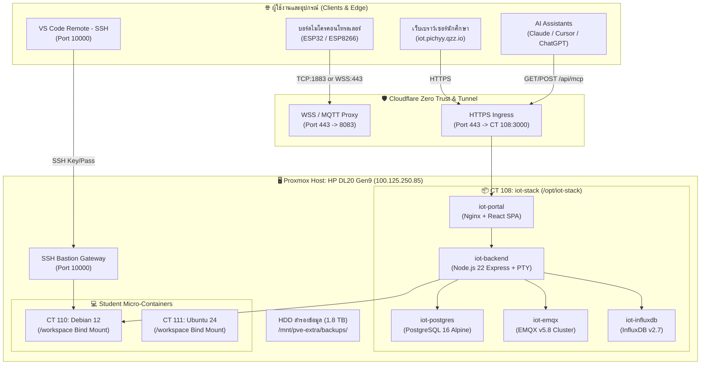

# LBTech IoT & Cloud CT Platform — Production Documentation & Handoff Handbook

> **สถานะระบบปัจจุบัน:** ออนไลน์ใช้งานจริง 100% (Production Grade - Live & Operational)  
> **URL พอร์ทัลหลัก:** [https://iot.pichyy.qzz.io](https://iot.pichyy.qzz.io)  
> **LLM Context Document:** [https://iot.pichyy.qzz.io/llms.txt](https://iot.pichyy.qzz.io/llms.txt)  
> **Model Context Protocol (MCP):** [https://iot.pichyy.qzz.io/api/mcp](https://iot.pichyy.qzz.io/api/mcp)  
> **อัปเดตล่าสุด:** 4 พฤศจิกายน 2026 (Full Enterprise Release)

---

## 1. ภาพรวมสถาปัตยกรรมระบบ (System Architecture)

ระบบ **LBTech IoT Platform & Cloud CT Portal** พัฒนาขึ้นสำหรับนักศึกษาแผนกเทคโนโลยีคอมพิวเตอร์ วิทยาลัยเทคนิคลพบุรี เป็นโครงสร้างพื้นฐาน IoT และ Cloud Container ส่วนกลางที่รวมบริการ 5 ด้านไว้ในระบบเดียว:
1. **MQTT Broker Hub (EMQX v5.8):** รับ-ส่งข้อความเซนเซอร์และการควบคุมแบบ Real-Time ผ่าน WebSocket (WSS 443) และ Native TCP (1883)
2. **Time-Series Database (InfluxDB v2.7):** จัดเก็บข้อมูล Telemetry ต่อเนื่อง 30 วัน พร้อม UI Flux Data Explorer
3. **Dedicated Linux Micro-Containers (LXC on Proxmox VE):** คอนเทนเนอร์ส่วนตัวสำหรับนักศึกษาแต่ละกลุ่ม (Debian 12, Ubuntu 24.04, Alpine 3.22) พร้อม Web Console xterm.js และ Bastion SSH Jump Host พอร์ต 10000
4. **Relational Database & Core Backend (PostgreSQL 16 + Node.js 22):** บันทึกบัญชีนักศึกษา, คำขอเครื่อง, Audit Logs, สถิติ Disk Storage, ประวัติการล็อกอิน, และ Support Tickets
5. **AI Integration Hub (MCP Server + LLM Prompts Hub + llms.txt):** เชื่อมโยงระบบเข้ากับ Claude Desktop, Cursor, ChatGPT, และ Gemini



---

## 2. ฟังก์ชันและระบบงานที่ติดตั้งแล้ว (Feature Breakdown)

### 2.1 หมวดหมู่ช่วยเหลือและระบบ AI (`ช่วยเหลือ (Support & AI)`)

#### 1) LLM Prompts Hub (`ai-prompts`)
- ศูนย์รวม Prompt คุณภาพสูงที่แนะนำให้นักเรียนใช้คุยกับ AI (ChatGPT, Claude, Gemini, DeepSeek, Cursor)
- **Auto-Credentials Interpolation:** ระบบอ่านข้อมูลกลุ่มที่ล็อกอินอยู่ แล้วแทรกค่าจริงลงใน Prompt อัตโนมัติ:
  - รหัสนักศึกษา, ชื่อโครงงาน, แผนกวิชา
  - Host MQTT, พอร์ต 443 / 1883, Topic Publish / Subscribe
  - Host InfluxDB, Organization (`lbtech`), Bucket ประจำตัว, และ Influx Token
  - คำสั่งเชื่อมต่อ SSH Bastion
- มีปุ่ม **[ คัดลอก Prompt ]** แบบ One-Click พร้อม Toast Notification
- รวม 5 หมวดหมู่คำสั่ง:
  1. *System Prompt / Persona:* มอบหมายให้ AI เป็น Senior IoT Engineer ประจำโครงงาน
  2. *ESP32 Arduino:* โค้ดเชื่อมต่อ WiFi + MQTT พร้อม Auto-reconnect และ Callback รับคำสั่งเปิดปิด Relay
  3. *Python Worker:* โค้ดรันใน Container ดึง MQTT เซฟลง InfluxDB และแจ้งเตือนผ่าน Discord/Line Notify
  4. *Web Dashboard:* โค้ด Single Page HTML + Tailwind + Chart.js ต่อ MQTT WebSocket ตรง
  5. *Troubleshooting & Debug:* เช็คลิสต์วิเคราะห์ข้อผิดพลาด Connection Refused, WSS 404, หรือ Token Auth

#### 2) Model Context Protocol (MCP) Server (`mcp-server`)
- ติดตั้ง Endpoint MCP ตามมาตรฐาน JSON-RPC 2.0 อย่างสมบูรณ์ที่:
  `https://iot.pichyy.qzz.io/api/mcp`
- รองรับการเชื่อมต่อกับ **Claude Desktop**, **Cursor IDE**, และ **Antigravity AI Agent**
- **คอนฟิกสำหรับ Claude Desktop (`claude_desktop_config.json`):**
  ```json
  {
    "mcpServers": {
      "lbtech-iot": {
        "command": "npx",
        "args": ["-y", "@modelcontextprotocol/server-fetch", "https://iot.pichyy.qzz.io/api/mcp"]
      }
    }
  }
  ```
- **คอนฟิกสำหรับ Cursor IDE (`~/.cursor/mcp.json`):**
  ```json
  {
    "mcpServers": {
      "lbtech-iot": {
        "url": "https://iot.pichyy.qzz.io/api/mcp"
      }
    }
  }
  ```
- **เครื่องมือ AI (Available MCP Tools):**
  - `lbtech_get_student_credentials(studentId)`: ดึงการตั้งค่า MQTT, InfluxDB, และ SSH
  - `lbtech_get_server_status(studentId)`: ตรวจสอบสถานะ Core, RAM, SSD, และ IP ของคอนเทนเนอร์
  - `lbtech_power_server(vmid, action)`: สั่งเปิด (start), ปิด (stop), หรือรีสตาร์ต (reboot) คอนเทนเนอร์
  - `lbtech_submit_ticket(studentId, subject, category, description)`: ยื่นตั๋วช่วยเหลือให้อัตโนมัติ
  - `lbtech_read_documentation(section)`: อ่านคู่มือฉบับเต็มของระบบ

#### 3) ระบบตั๋วช่วยเหลือและติดต่ออาจารย์ (Support Tickets System - `/tickets`)
- พัฒนาตามแนวทาง `/clean-ui-design`: โทนสี Neutral Zinc, ป้ายสถานะชัดเจน, ฟอร์มกะทัดรัด
- **ฝั่งนักศึกษา:**
  - ยื่นคำร้อง 4 หมวด: *ขอเพิ่มทรัพยากร (RAM/vCPU/Storage), ปัญหาเครือข่าย/Port/Bastion, ขอรีเซ็ตรหัสผ่าน/Token, และสอบถามทั่วไป*
  - ตรวจสอบประวัติคำร้อง สถานะการดำเนินการ (`รอตรวจสอบ`, `กำลังดำเนินการ`, `แก้ไขเสร็จสิ้น`) และข้อความตอบกลับจากอาจารย์
- **ฝั่งอาจารย์ผู้ดูแลระบบ (Admin Console):**
  - แท็บ **"คำร้อง & ช่วยเหลือ"** แสดงรายการคำร้องทั้งหมด กรองตามสถานะได้
  - กล่องพิมพ์ข้อความตอบกลับและปุ่มเปลี่ยนสถานะคำร้องแบบ Real-Time
  - ข้อมูลจัดเก็บลงตาราง `support_tickets` ใน PostgreSQL 16 พร้อมระบบ Sync ถาวร

#### 4) ระบบแชร์บริบทระบบให้ AI (`llms.txt` และ `robots.txt`)
- **Machine-Readable Documentation:** เผยแพร่ที่ [`https://iot.pichyy.qzz.io/llms.txt`](https://iot.pichyy.qzz.io/llms.txt)
- **Robots Signal:** เผยแพร่ที่ [`https://iot.pichyy.qzz.io/robots.txt`](https://iot.pichyy.qzz.io/robots.txt)
- **ปุ่มบน Top Navbar:** ปุ่ม **"ส่งให้ AI (llms.txt)"** คัดลอกลิงก์พร้อมข้อความกำกับให้นักศึกษาส่งให้ AI อ่านเข้าใจโครงสร้างระบบทั้งเว็บได้ทันที

---

### 2.2 โครงสร้างพื้นฐานระดับ Enterprise (Enterprise Infrastructure)

#### 1) ฐานข้อมูลเชิงสัมพันธ์ PostgreSQL 16 Alpine (`iot-postgres`)
- รันเป็น Container คู่ขนานกับ Backend บนพอร์ตภายใน `5432`
- ตารางฐานข้อมูลหลัก:
  - `students`: ข้อมูลทะเบียนนักศึกษา โครงงาน และ JSON Credentials
  - `ct_requests`: รายการยื่นคำขอเครื่องเซิร์ฟเวอร์
  - `ct_servers`: ข้อมูลเครื่องคอนเทนเนอร์ สเปก และ IP
  - `audit_logs`: บันทึกกิจกรรมระบบและการกระทำของแอดมิน
  - `login_security`: บันทึกการพยายามล็อกอินผิดและระยะเวลาปลดล็อก
  - `support_tickets`: รายการคำร้องและการตอบกลับของอาจารย์

#### 2) การจำกัดขนาด Disk Storage บนฮาร์ดดิสก์จริง (Disk Quota Enforcement)
- คำนวณขนาดการใช้พื้นที่จริงใน `/workspace` ของแต่ละคอนเทนเนอร์ (`getWorkspaceDiskUsageMB`)
- ส่งค่าเปอร์เซ็นต์และขนาด MB ผ่าน Server-Sent Events (SSE) Stream
- แสดงแถบ Progress Bar พื้นที่ SSD บนหน้าเว็บแบบ Real-Time หากเกินโควตาจะขึ้นเตือนและล็อกการเขียนไฟล์ขนาดใหญ่

#### 3) ระบบป้องกันการเดารหัสผ่านซ้ำๆ (Brute-Force & Rate Limiting)
- ดักจับการล็อกอินผิดที่ `/api/auth/login` และการกรอก Admin PIN ผิดที่ `/api/admin/verify-pin`
- หากกรอกผิดครบ 5 ครั้ง ระบบจะสั่งล็อก IP / Student ID ทันทีเป็นเวลา 10-15 นาที (HTTP 429 Too Many Requests)

#### 4) ระบบสำรองข้อมูลออกนอกเครื่องอัตโนมัติ (Automated Physical HDD Backup)
- ติดตั้งสคริปต์สำรองข้อมูลที่โฮสต์: `/usr/local/bin/backup-lbtech-iot.sh`
- เป้าหมายการสำรอง: ฮาร์ดดิสก์กายภาพขนาด 1.8 TB ไดรฟ์ `/mnt/pve-extra` (`/dev/sdb1`)
- ตำแหน่งไฟล์สำรอง: `/mnt/pve-extra/backups/lbtech-iot/`
- สำรองข้อมูล 3 ส่วนสำคัญ:
  1. ไฟล์ SQL Dump ของ PostgreSQL (`lbtech_iot_*.sql.gz`)
  2. ไฟล์ JSON State Cache (`iot_storage_*.json`)
  3. ไฟล์ Docker Compose และ Config Environment
- Cronjob อัตโนมัติ: ทำงานทุกวันเวลา **02:30 AM** (`/etc/cron.d/lbtech-iot-backup`)
- เก็บประวัติย้อนหลัง 14 วัน และลบไฟล์เก่าทิ้งอัตโนมัติเพื่อประหยัดพื้นที่

#### 5) หน้าต่าง Web Terminal Popout แบบ Standalone (`/terminal/:vmid`)
- รองรับการเปิด Terminal ในหน้าต่างแยกขนาดเต็มจอ ผ่าน URL:
  `https://iot.pichyy.qzz.io/terminal/{vmid}`
- แก้ไขปัญหา Nginx Routing และ React SPA State ให้แสดงผลหน้าคอนโซลทันที พร้อมปุ่มปิดหน้าต่างอัตโนมัติ

---

## 3. ข้อมูลการเชื่อมต่อและพอร์ตบริการ (Service Endpoints & Credentials)

| บริการ | URL / Port | ผู้ใช้ / รหัสผ่าน | วัตถุประสงค์ |
| :--- | :--- | :--- | :--- |
| **IoT Web Portal** | `https://iot.pichyy.qzz.io` | บัญชีนักศึกษา | หน้าเว็บหลัก, คอนโซล, จัดการเครื่อง, Support |
| **Machine Context (llms.txt)** | `https://iot.pichyy.qzz.io/llms.txt` | สาธารณะ | เอกสารระบบฉบับย่อสำหรับ LLMs & AI |
| **Model Context Protocol (MCP)** | `https://iot.pichyy.qzz.io/api/mcp` | JSON-RPC 2.0 | เชื่อมต่อ Claude Desktop / Cursor |
| **Support Tickets API** | `https://iot.pichyy.qzz.io/api/tickets` | REST JSON | ยื่นคำร้องและตอบกลับแอดมิน |
| **EMQX Dashboard** | `https://emqx.pichyy.qzz.io` | `tc-iotadmin` / `Techniccom.IoT2026` | แดชบอร์ดมอนิเตอร์ MQTT Cluster |
| **MQTT Broker (WSS ภายนอก)** | `wss://mqtt.pichyy.qzz.io/mqtt` (Port 443) | รหัสนักศึกษา | ส่ง Telemetry ผ่าน Cloudflare WSS |
| **MQTT Broker (Native TCP)** | `mqtt.pichyy.qzz.io:1883` | รหัสนักศึกษา | ส่ง Telemetry จาก ESP32 / Arduino |
| **InfluxDB Web UI** | `https://influx.pichyy.qzz.io` | `iotadmin` / `Techniccom.Influx2026` | หน้าค้นหาข้อมูล Time-series & Flux Builder |
| **PostgreSQL 16** | `localhost:5432` (CT 108 ภายใน) | `iotuser` / `Techniccom.Postgres2026!` | ฐานข้อมูลหลัก `lbtech_iot` |
| **SSH Bastion Gateway** | `techniccom.tail59415d.ts.net:10000` | รหัสนักศึกษา | SSH ข้ามเครือข่ายเข้าสู่ Container |
| **Proxmox VE Host** | `https://100.125.250.85:8006` | `tc-admin` / `07072569` | ไฮเปอร์ไวเซอร์แม่ข่าย |

---

## 4. คำสั่งสำหรับผู้ดูแลระบบ (Operations & Maintenance)

### 4.1 ตรวจสอบสถานะคอนเทนเนอร์บน CT 108
```bash
# SSH เข้าสู่ Proxmox Host
ssh tc-admin@100.125.250.85

# ตรวจสอบ Docker Container ใน CT 108
pct exec 108 -- docker ps --format "table {{.Names}}\t{{.Status}}\t{{.Ports}}"
```

### 4.2 ตรวจสอบและสั่ง Backup ฐานข้อมูลลง HDD ทันที
```bash
# รันสคริปต์สำรองข้อมูลทันที
sudo /usr/local/bin/backup-lbtech-iot.sh

# ดูรายการไฟล์สำรองบนไดรฟ์ pve-extra
ls -lh /mnt/pve-extra/backups/lbtech-iot/
```

### 4.3 ตรวจสอบข้อมูลใน PostgreSQL ผ่าน CLI
```bash
# ตรวจสอบจำนวนนักศึกษาและตั๋วช่วยเหลือ
pct exec 108 -- docker exec -it iot-postgres psql -U iotuser -d lbtech_iot -c "\
  SELECT count(*) AS total_students FROM students;\
  SELECT count(*) AS total_tickets FROM support_tickets;\
  SELECT count(*) AS active_servers FROM ct_servers;"
```

### 4.4 การ Build และ Deploy Frontend / Backend
```bash
# Build Frontend
npm --prefix iot-portal run build

# แพ็กเกจและอัปโหลดขึ้นเซิร์ฟเวอร์
node scratch/deploy_all.cjs
```

### 4.5 ระบบ Web Preview และ Fallback Page อัตโนมัติ
- **URL เข้าชมเว็บทันที (Path-based):** `https://iot.pichyy.qzz.io/preview/:studentId/`
- **กลไกการทำงาน:**
  - Nginx ส่งต่อไปยัง `iot-backend:5000/api/preview/:studentId`
  - Backend ค้นหาคอนเทนเนอร์เป้าหมายและเชื่อมต่อไปยังพอร์ตของนักศึกษา (Default: 80 หรือพอร์ตที่ตั้งค่าไว้ เช่น 3000, 5000)
  - **หากเว็บเซิร์ฟเวอร์ยังไม่พร้อมใช้งาน:** ระบบจะส่งคืนหน้า **Fallback Page ภาษาไทย** แสดงสถานะ, ข้อมูลกลุ่ม, และปุ่มคัดลอก **1-Click Starter HTML Dashboard** ไปรันใน Terminal พร้อมเวลานับถอยหลังรีเฟรชอัตโนมัติ

### 4.6 กลไก Terminal Keepalive และ Auto-Reconnect
- ไคลเอนต์ส่ง `{ type: 'ping' }` ทุก 10 วินาที
- เซิร์ฟเวอร์ส่ง `{ type: 'pong' }` ตอบกลับ และส่ง `{ type: 'heartbeat' }` ทุก 15 วินาที
- ป้องกัน Cloudflare Edge และ Nginx ตัดการเชื่อมต่อขณะรันคำสั่งยาวนาน เช่น `apt update` หรือคอมไพล์โค้ด
- หากการเชื่อมต่อหลุด ระบบจะกู้คืนเซสชันใหม่อัตโนมัติใน 3 วินาทีโดยไม่สูญเสียประวัติหน้าจอ xterm
- หน้าต่าง Popout Terminal อิสระรองรับที่ `/terminal/:vmid` และ `#/terminal/:vmid` แสดงผลเต็มหน้าต่างทันที

### 4.7 ระบบ Subdomain ประจำกลุ่ม (Single-Level Subdomain)
- **รูปแบบ:** `https://<studentId>.pichyy.qzz.io` (เช่น `https://69123456789.pichyy.qzz.io`)
- **Cloudflare Tunnel Routing:** โฮสต์กำหนด Ingress `*.pichyy.qzz.io` ชี้เข้าสู่ `http://10.10.10.108:3000`
- **Nginx Ingress:** Regex `~^(?<std_id>[0-9a-zA-Z_-]+)\.pichyy\.qzz\.io$` ส่งต่อเข้าสู่ `/api/preview/$std_id$request_uri`
- **การตั้งค่าใน Cloudflare DNS:** เพิ่ม CNAME Name: `*` หรือ `<studentId>` ชี้ไปยัง `ae270dc3-cd44-46cb-abd6-3a409f94d423.cfargotunnel.com` (เปิด Proxied)


