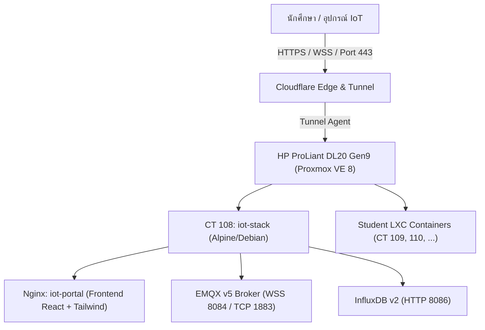

# LBTech IoT & Cloud CT Portal — Handoff Document

> **สถานะระบบปัจจุบัน:** ออนไลน์ใช้งานได้จริง (Live Production)  
> **URL หลักของระบบ:** [https://iot.pichyy.qzz.io](https://iot.pichyy.qzz.io)  
> **อัปเดตล่าสุด:** 3 พฤศจิกายน 2026

---

## 1. ภาพรวมระบบ (System Architecture)

ระบบ **LBTech IoT Platform & Cloud CT Portal** พัฒนาขึ้นสำหรับนักศึกษาแผนกเทคโนโลยีคอมพิวเตอร์ วิทยาลัยเทคนิคลำปาง เพื่อใช้เป็นระบบศูนย์กลางในการเรียนการสอน ทำโครงงาน IoT และขอเครื่องเซิร์ฟเวอร์เสมือน (LXC Container)



### โครงสร้างฮาร์ดแวร์และโฮสต์
- **Server:** HP ProLiant DL20 Gen9 (Intel Xeon E3, 16GB RAM, SSD Storage `pve-extra`)
- **Proxmox VE Host IP:** `192.168.1.141`
- **Host User:** `tc-admin` / `07072569`
- **Main Stack Container:** CT 108 (ID: `108`, Path: `/opt/iot-stack`)
- **Public Domain:** `pichyy.qzz.io`

---

## 2. ฟีเจอร์ที่พัฒนาและปรับปรุงล่าสุด

### 2.1 ระบบขอเครื่องเซิร์ฟเวอร์เสมือน (Cloud CT Provisioning)
- **Lifecycle ครบวงจร 5 สถานะ:**
  1. *Empty State:* หน้าต้อนรับแสดงปุ่ม `[ + ขอเครื่องเซิร์ฟเวอร์ ]`
  2. *Request Form:* ฟอร์มกรอกชื่อ Hostname, เลือกระบบปฏิบัติการ, จัดสรรทรัพยากร และระบุวัตถุประสงค์
  3. *Pending State:* การ์ดสถานะสีเหลืองอำพัน `[ ⏳ รออนุมัติ (Pending) ]` พร้อมสเปกที่ขอและปุ่มยกเลิก/อนุมัติ
  4. *Active State:* การ์ดสถานะสีเขียว `[ 🟢 ปกติ (Online) ]` พร้อมปุ่ม `[ >_ เปิด Web Console ]`, ปุ่มควบคุม Power (Start/Stop/Reboot) และคำสั่ง SSH Gateway
  5. *Header Button:* เมื่อมีเครื่องแล้ว ปุ่มขอเครื่องจะย้ายไปอยู่ข้างชื่อหัวข้อ
- **UI ดีไซน์ Clean & ประหยัดเนื้อที่ (Latest Refactoring):**
  - **Zero Nested Cards:** ตัด Card ซ้อน Card ออก ฟิลด์ฮาร์ดแวร์กลมกลืนเป็นส่วนหนึ่งของฟอร์ม
  - **ปุ่มชิปขนาดพอดีข้อความ (`h-8 px-3.5`):**
    - `vCPU`: Stepper ขนาดกะทัดรัด `[-] 1 Core [+]` พร้อมปุ่มชิปเลือกด่วน `1 Core` / `2 Cores` ในแถวเดียว
    - `RAM`: ปุ่มชิปแนวนอน `512 MB`, `1 GB`, `2 GB`, `4 GB`
    - `Storage SSD NVMe`: ปุ่มชิปแนวนอน `5 GB`, `10 GB`, `15 GB`, `20 GB`, `30 GB`
  - **Logo OS เด่นชัด ไร้กรอบ:** ขยายโลโก้ทางการของ Debian 12, Ubuntu 24.04, Alpine 3.22 ขนาดใหญ่ (`h-8 w-8`) ไร้กรอบสีเทา
  - **ปุ่มย้อนกลับ (Back Button):** ไร้กรอบสี่เหลี่ยม ย้ายไปอยู่หน้าชื่อหัวข้อ `บริการเครื่องเซิร์ฟเวอร์ (Cloud CT Provisioning)` อย่างลงตัว
  - **นำปุ่มอาจารย์ออกจาก Navbar:** เพื่อความเป็นระเบียบสำหรับนักศึกษา และเพิ่มปุ่ม `[ อนุมัติ ]` ในการ์ดสถานะรออนุมัติสำหรับการทดสอบ

### 2.2 ข้อกำหนดและเงื่อนไขการใช้งาน (Server Terms of Service)
Modal บรรจุข้อกำหนดฉบับเต็มของแผนก 9 ข้ออย่างสมบูรณ์:
1. ขอบเขตและวัตถุประสงค์การใช้งาน (เพื่อการศึกษาเท่านั้น, ห้ามเชิงพาณิชย์)
2. การกำกับดูแลและการปรึกษาอาจารย์ที่ปรึกษา (การขอความเห็นชอบก่อนขึ้น Production, เปิดพอร์ต, API)
3. การจัดสรรและการใช้งานทรัพยากร (Fair Use, ห้าม Infinite Loop / Memory Leak, ควบคุม Cronjob)
4. การทดสอบระบบและการจำลองโหลด (ห้ามสแกนเจาะระบบโดยพลการ, ข้อบังคับ Sandbox & Mock Data)
5. ความมั่นคงปลอดภัยของระบบ (Password Policy, ห้าม Hardcode รหัสผ่าน, จำกัดพอร์ต DB)
6. ข้อห้ามและการปฏิบัติตามกฎหมาย (พ.ร.บ. คอมพิวเตอร์ฯ, ห้ามขุดคริปโต, ห้าม VPN หลบไฟร์วอลล์)
7. การคุ้มครองข้อมูลส่วนบุคคล (PDPA Compliance, Data Minimization, Password Hashing)
8. การดูแลรักษาข้อมูลและการสำรองข้อมูล (นักศึกษารับผิดชอบ Backup, ขอบเขต AS-IS)
9. การบำรุงรักษาระบบ อายุการใช้งาน และการสิ้นสุดสิทธิ์ (ล้างเครื่องภายใน 7 วันหลังสิ้นสุดภาคการศึกษา)

### 2.3 การปรับแต่ง Theme & UI
- **Pure Neutral Zinc Styling:** คุมโทนสีเทากลาง (`#fafafa` / `#09090b` / `#121214`) ปราศจากสีฟ้า/น้ำเงินเจือปน
- **Dark / Light / System Mode:** สลับธีมได้ทันที ซิงค์ทั้งเว็บและ Monaco Editor
- **Responsive 100%:** รองรับทั้งจอมือถือ แท็บเล็ต และเดสก์ท็อป

---

## 3. ข้อมูลการเชื่อมต่อและพอร์ต (Endpoints & Credentials)

| บริการ | URL / Port | ผู้ใช้ / รหัสผ่าน | หมายเหตุ |
| :--- | :--- | :--- | :--- |
| **IoT Web Portal** | `https://iot.pichyy.qzz.io` | เข้าใช้งานได้ทันที | หน้าเว็บหลัก + Docs + Console |
| **EMQX Dashboard** | `https://emqx.pichyy.qzz.io` | `admin` / `07072569` | มอนิเตอร์ Broker ส่วนกลาง |
| **InfluxDB UI** | `https://influxdb.pichyy.qzz.io` | `lbtech-admin` / `07072569` | ฐานข้อมูล Time-series |
| **MQTT WebSocket** | `wss://iot.pichyy.qzz.io/mqtt` | ตามรหัสนักศึกษา | พอร์ต 443 ผ่าน Cloudflare |
| **SSH Gateway** | `ssh.pichyy.qzz.io:2222` | `root` / ตามรหัสนักศึกษา | SSH เข้าสู่ CT นักศึกษา |

---

## 4. ขั้นตอนการ Build และ Deploy

### 4.1 Build Frontend
```bash
cd iot-portal
npm run build
```

### 4.2 Push ไปยังเซิร์ฟเวอร์ CT 108
ใช้สคริปต์อัตโนมัติ `push_portal_update.py`:
```bash
python C:\Users\Newsk\.gemini\antigravity\brain\9ca5c64a-e192-46da-a634-f9ef70d2fed6\scratch\push_portal_update.py
```
*สคริปต์จะทำการแพ็ก `dist/`, อัปโหลดผ่าน SFTP เข้า Proxmox Host, ส่งไฟล์เข้า CT 108 ด้วย `pct push` และสั่ง `docker compose up -d --build portal` ให้อัตโนมัติ*

---

## 5. แผนการพัฒนาต่อไป (Next Steps / Roadmap)

1. **Proxmox API Automated Provisioning:**
   - เชื่อมต่อ Backend API กับ Proxmox VE REST API (`/api2/json/nodes/pve-host/lxc`) เพื่อสร้าง CT จริงโดยอัตโนมัติเมื่อกดอนุมัติ
2. **Web Terminal Integration:**
   - เชื่อมต่อ `WebTerminalModal` เข้ากับ ttyd หรือ xterm.js WebSocket ชี้ตรงไปที่คอนเทนเนอร์ของนักศึกษา
3. **Database Telemetry Auto-Provisioning:**
   - สร้าง InfluxDB Bucket และ EMQX User ตามรหัสนักศึกษาโดยอัตโนมัติ
